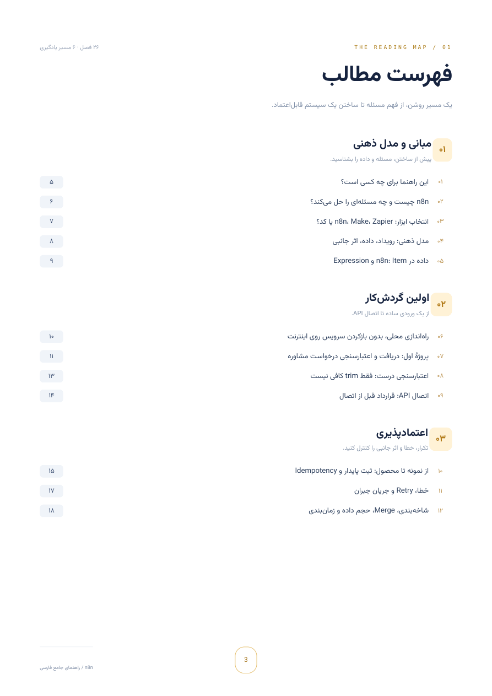
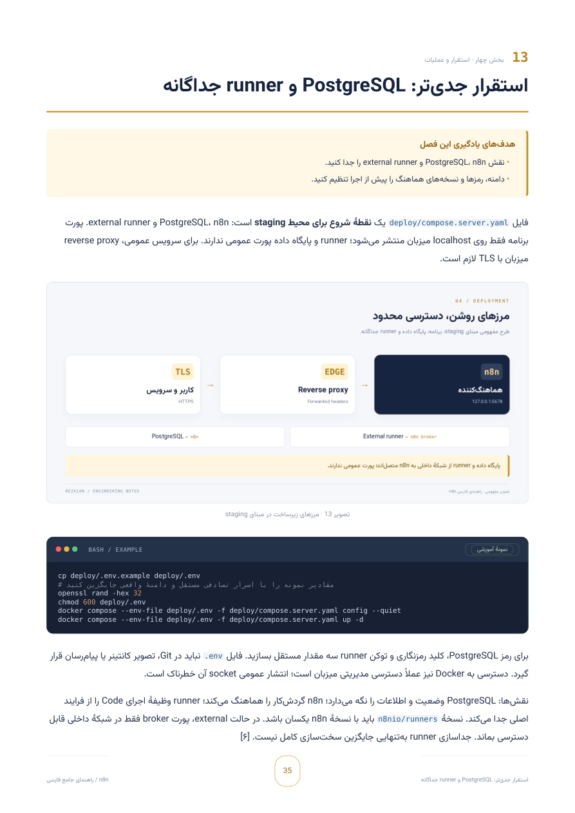

# 📚 مرجع جامع و پروژه‌محور n8n

### فقط ابزارها را وصل نکنید؛ سیستم بسازید.

**از مدل ذهنی تا طراحی، آزمون و بازیابی اتوماسیون قابل‌اعتماد**

نویسنده و گردآورنده: **محمدرضا رضائیان**

[**🌐 شروع مطالعهٔ آنلاین**](https://rezaian-dev.github.io/n8n-persian-guide/book/) • [**📕 دریافت PDF**](https://rezaian-dev.github.io/n8n-persian-guide/N8N-Persian-Guide.pdf)

**۷۱ صفحهٔ PDF · ۲۶ فصل · ۷۶ پرسش با پاسخ تحلیلی · ۶ تصویر مفهومی**

[معرفی کتاب](https://rezaian-dev.github.io/n8n-persian-guide/) · [فایل PDF در مخزن](docs/N8N-Persian-Guide.pdf)

## ✨ یک مرجع برای فهمیدن، نه حفظ‌کردن

از **داده، Expression و Webhook** تا **ثبت پایدار، Idempotency، مدیریت خطا، استقرار امن، بازیابی و AI کنترل‌شده**؛ همراه با مثال حل‌شده، سناریوی شکست، تمرین و معیار پذیرش.

این راهنما برای توسعه‌دهندگان وب، تیم‌های محصول و عملیات و سازندگان اتوماسیون هوشمند نوشته شده است. آشنایی مقدماتی با JSON، HTTP و خط فرمان، شروع مطالعه را آسان‌تر می‌کند.

## 📖 بخوانید یا دانلود کنید

| نسخه | امکانات | دسترسی |
| --- | --- | --- |
| 🌐 **مطالعهٔ آنلاین** | متن کامل، منوی کشویی متحرک موبایل، ظاهر شیشه‌ای، تم روشن و تیره، جست‌وجو، تنظیم قلم، کپی کد و ادامهٔ مطالعه | [شروع خواندن](https://rezaian-dev.github.io/n8n-persian-guide/book/) |
| 📕 **PDF** | ۷۱ صفحهٔ A4، متن قابل جست‌وجو، فهرست نقطه‌چین و لینک‌دار، بوک‌مارک، تصویر و تمرین | [دانلود کتاب](https://rezaian-dev.github.io/n8n-persian-guide/N8N-Persian-Guide.pdf) |

بدون نصب و ثبت‌نام. نسخهٔ آنلاین تصویر صفحات PDF نیست؛ متن واقعی کتاب است. تنظیمات و آخرین فصل فقط در مرورگر شما ذخیره می‌شوند.

## 🧭 نقشهٔ مطالعه

| مسیر | موضوع‌ها | شروع |
| --- | --- | --- |
| 🧩 **مبانی و مدل ذهنی** | انتخاب ابزار، رویداد و اثر جانبی، Item و Expression | [فصل‌های ۱ تا ۵](https://rezaian-dev.github.io/n8n-persian-guide/book/#chapter-1) |
| 🔌 **اولین گردش‌کار** | محیط محلی، دریافت درخواست، اعتبارسنجی و API | [فصل‌های ۶ تا ۹](https://rezaian-dev.github.io/n8n-persian-guide/book/#chapter-6) |
| 🛡️ **اعتمادپذیری** | ثبت پایدار، Idempotency، Retry، جبران و Merge | [فصل‌های ۱۰ تا ۱۲](https://rezaian-dev.github.io/n8n-persian-guide/book/#chapter-10) |
| ⚙️ **استقرار و عملیات** | PostgreSQL، runner، TLS، امنیت، پایش و بازیابی | [فصل‌های ۱۳ تا ۱۸](https://rezaian-dev.github.io/n8n-persian-guide/book/#chapter-13) |
| 🧠 **AI کنترل‌شده** | مدل و عامل، RAG، MCP، تأیید انسانی و دستیار پشتیبانی | [فصل‌های ۱۹ تا ۲۲](https://rezaian-dev.github.io/n8n-persian-guide/book/#chapter-19) |
| 🧪 **تست و انتشار** | ارزیابی، عیب‌یابی، نقشهٔ راه و چک‌لیست انتشار | [فصل‌های ۲۳ تا ۲۶](https://rezaian-dev.github.io/n8n-persian-guide/book/#chapter-23) |

📋 [بانک سناریوهای مصاحبه](https://rezaian-dev.github.io/n8n-persian-guide/book/#chapter-27) · 🔗 [منابع رسمی](https://rezaian-dev.github.io/n8n-persian-guide/book/#chapter-28)

## 🖼️ داخل کتاب

تصاویر واقعی از PDF منتشرشده:

| فهرست لینک‌دار | استقرار و زیرساخت |
| :---: | :---: |
|  |  |

## ℹ️ دربارهٔ این انتشار

- **آخرین بررسی منابع:** ۱ نوامبر ۲۰۲۶؛ **مبنای مثال‌ها:** n8n 2.45.7. این‌ها مبنای تدوین‌اند، نه تضمین تازه‌ترین نسخه در آینده.
- مثال‌ها آموزشی‌اند؛ اجرای واقعی n8n، سرویس‌های خارجی، TLS و بازیابی باید در محیط مقصد بررسی شوند. موفقیت تست‌های مستقل به معنی آمادگی پروداکشن نیست.
- این مخزن **فقط نسخهٔ نهایی انتشار** را نگه می‌دارد: PDF، صفحات آنلاین و دارایی‌های لازم برای نمایش آن‌ها. ابزار ساخت، تست، تنظیمات استقرار و کد آزمایشگاه در شاخهٔ فعلی قرار ندارند.
- برای اجرای تمرین‌های کتاب، [آرشیو نسخهٔ آموزشی](https://github.com/rezaian-dev/n8n-persian-guide/tree/915a235ade583da03c49be96fabb1834ead07e19) و راهنمای دریافت آن در فصل ۶ در دسترس است.

## 👤 نویسنده و حقوق اثر

**محمدرضا رضائیان — Front-End Engineer**

[پورتفولیو](https://rezaian-dev.vercel.app/fa) · [GitHub](https://github.com/rezaian-dev) · [گزارش اصلاح](https://github.com/rezaian-dev/n8n-persian-guide/issues)

تهیه‌شده با کمک ابزارهای پژوهش و نگارش هوش مصنوعی. حقوق متن، طراحی، تصویرها و عکس محفوظ است؛ [حقوق اثر و مجوزهای ثالث](LICENSE.md) را ببینید. Motion با MIT و Vazirmatn با SIL OFL استفاده شده‌اند؛ مجوزهایشان همراه فایل‌هاست. این راهنما مستقل است و وابسته یا مورد تأیید n8n نیست.

برای گزارش اصلاح، فصل و نسخهٔ نرم‌افزار را مشخص کنید. اعتبارنامه یا دادهٔ خصوصی منتشر نکنید. گزارش امنیتی خصوصی: **mrezaian.dev@gmail.com**.

