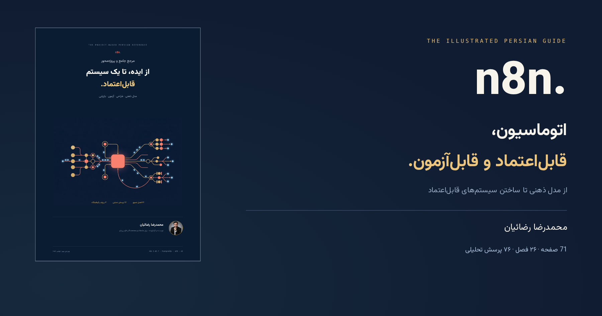

<div align="center">



# n8n Persian Guide

### From connected tools to reliable systems

**Written and curated by Mohammadreza Rezaian**

[**Download the PDF**](docs/N8N-Persian-Guide.pdf) · [**Explore the book website**](https://rezaian-dev.github.io/n8n-persian-guide/) · [**Read the source**](guide.md)

**71 designed A4 pages · 26 chapters · 76 answered interview questions · 3 projects/labs · 34 independent tests**

</div>

## What this repository contains

An expanded, project-based Persian reference to n8n: data and expressions, webhooks, API integration, input validation, idempotency, error handling, deployment, security, observability, recovery, and controlled AI workflows.

The **PDF is the primary deliverable**. Its editorial layout is inspired by the author's [TypeScript Persian Guide](https://github.com/rezaian-dev/typescript-persian-guide): independent chapter openings, learning objectives, navy-and-gold accents, syntax-highlighted code frames, exercises, acceptance checks, a three-page chapter-level table of contents with true dotted leaders and automatic page destinations, and 194 PDF bookmarks. The simplified contents uses 12pt chapter labels; subsection navigation remains available in PDF bookmarks. Running furniture uses a thin aligned rule, a short title/wordmark and a centered page number. Contents pages have no running header or extra kicker above the title. Twenty-six topic-specific vector chapter icons and semantic objective, interview and exercise icons are typeset directly into the PDF; no emoji fonts or remote icon service is used.

The cover is entirely flat: an AI-generated conceptual automation illustration, searchable typeset title/author text, and the original author portrait are separate elements. There is no 3D book mockup, perspective transform or generated portrait. The website presents the same conceptual art without tilting; real PDF previews remain separate.

The website is a **book introduction and download page**, not a duplicate full-text reader. It features real PDF previews, chapter-to-PDF links, a responsive book presentation, and locally bundled **Motion 14.9.0** animations. Reduced-motion preferences are respected. Fine-pointer button motion uses bounded magnetic offsets (up to 6px horizontally) and spring-based Motion animations, with listener/frame cleanup on pointer exit. No CDN, analytics, tracking, or runtime framework is required.

The reference-edition website uses a coordinated deep-navy, sea-glass teal and champagne palette, a framed sticky header with an accessible mobile disclosure menu, and an essential-only footer with PDF, repository and author links. It adds a flat editorial hero, three selectable reading paths, client-side chapter search with Persian/Arabic character normalization, keyboard-accessible large-page previews, an interview sample, and a mobile download strip. Core downloads and native contents still work without JavaScript. Desktop, mobile (including 320px), reduced-motion and no-JavaScript paths were checked.

**Documentation reviewed:** November 1, 2026. **Example baseline:** n8n 2.45.7. These are dated references, not a claim that this version will always be current.

## Read, then build

| Track | Topics |
| --- | --- |
| Foundations | Events, nodes, items, expressions, tool selection, licensing |
| First workflow | Local setup, webhooks, validation, HTTP responses, APIs |
| Reliability | Durable intake, duplicate handling, retries, compensation |
| Operations | PostgreSQL, external runners, TLS, security, queue mode, recovery |
| Controlled AI | Structured output, RAG, tool permissions, human approval |
| Verification | Evaluation, troubleshooting, release checks, learning roadmap |

The expanded source contains mental models, worked examples, failure analyses, exercises, 52 chapter-specific interview questions and 24 additional scenario questions with analytical answers. The PDF adds chapter objectives and acceptance-check panels maintained in `scripts/book-notes.json`. Reading is not a promise of mastery: run the labs, explain failures, and transfer the ideas to new cases.

The accompanying [independent labs](projects/README.md) cover transactional intake/outbox with lease ownership and strict AI output, document ACLs and approval binding. They deliberately do not pretend to be live n8n/provider integrations.

## Try the local example

Requires Docker with Compose. Use **synthetic data only**.

```bash
git clone https://github.com/rezaian-dev/n8n-persian-guide.git
cd n8n-persian-guide
docker compose -f deploy/compose.local.yaml up -d
```

Open `http://localhost:5678`, create a local owner account, and import [`workflows/lead-intake.json`](workflows/lead-intake.json). Follow chapter 7 of the PDF.

The demonstration validates a lead and returns HTTP `200` or `422`. It **does not persist submissions, contact a CRM, or send messages**. Its unauthenticated webhook is intended only for isolated local testing. Do not expose it publicly without authentication, rate limiting, and an appropriate security review.

The server Compose file is a **staging starting point**, not a complete production deployment. Replace every secret in `deploy/.env.example`, keep n8n and runner versions aligned, configure HTTPS through a host reverse proxy, and test recovery. Never use `down -v` on data you need to retain.

## Build and validate

Requires Python 3.10+, Node.js 20+, and the system libraries required by WeasyPrint, including Pango, HarfBuzz, Fontconfig, and DejaVu Sans Mono. See the [WeasyPrint installation guide](https://doc.courtbouillon.org/weasyprint/stable/first_steps.html#installation) for OS-specific setup.

```bash
python -m pip install -r requirements.txt
npm test
python -m unittest discover -s tests -p 'test_*.py' -v
python scripts/build_pdf.py
python scripts/build.py
python scripts/check.py
python scripts/check_pdf.py
python -m http.server 8080 --directory docs
```

The PDF builder also renders the real cover and sample-page previews. Committed metadata supplies the website's page count, download size, and exact PDF chapter links. Source and layout hashes detect a stale PDF.

To regenerate the original illustrations, install the optional artwork tooling:

```bash
python -m pip install playwright==1.64.1
python -m playwright install --with-deps chromium
python scripts/build_figures.py
python scripts/build_pdf.py
python scripts/build.py
```

The distributed images are already included; normal reading, website hosting, and CI do not require Playwright.

## Verification and limitations

- **22 Node.js tests** cover lead validation, item linkage, workflow structure, strict AI schemas, document eligibility, tool scope and approval binding.
- **12 Python tests** cover atomic intake/outbox, concurrent duplicates, payload conflict, rollback, lease expiry, stale ownership, retry delay and restart persistence.
- These **34 independent tests** do not execute the n8n runtime, Docker, a real AI model or external tools. A pure approval check is not an authenticated approval service or one-time execution guarantee.
- PDF checks cover source/layout freshness, page metadata, searchable text, bookmarks, internal destinations, and text outside page bounds. During typesetting, all 130 learning-icon placements are checked for dedicated slot containment, centering (within one CSS pixel), and text-box overlap. Print panels use fixed table-cell geometry rather than floats, flex gaps or inline SVG baselines.
- Website checks validate local assets and links. Desktop/mobile checks also exercised theme switching, contents expansion, and PDF downloads.
- Motion effects were checked with normal and reduced-motion preferences. Motion and its MIT license are stored locally under `docs/assets/vendor/`.
- PDF covers, representative pages, and a thumbnail overview were visually reviewed. This is not a complete human copyedit or a PDF/UA accessibility certification.
- Full workflow import/execution inside n8n, Docker startup, external services, TLS, load capacity, and backup restoration still require testing in the target environment. AI sections include tested isolated policy code and implementation designs, not live connected agents.

## Repository layout

```text
.
├── guide.md                       # Expanded Persian reference source
├── docs/
│   ├── N8N-Persian-Guide.pdf       # Primary publication
│   ├── index.html                 # Generated book landing page
│   ├── assets/                    # Local font, author photo, Motion, site assets
│   ├── figures/                   # Six original technical illustrations
│   └── previews/                  # Images rendered from the actual PDF
├── workflows/lead-intake.json      # Importable local demonstration
├── examples/normalize-lead.js      # Dependency-free validation logic
├── projects/                      # Durable intake and AI boundary learning labs
├── tests/                         # 22 Node.js + 12 Python independent tests
├── deploy/                        # Local/staging Compose and proxy example
└── scripts/                       # Publication sources, builders, and checks
```

There is one distributed PDF and no duplicate HTML reader, duplicate deployment documentation, dependency directories, private environment files, or test screenshots in the repository. The generated website and publication assets are retained because GitHub Pages serves them directly.

## Repository language statistics

`.gitattributes` keeps the GitHub Languages bar focused on the reader-facing **HTML, CSS and JavaScript**. Python files are explicitly non-detectable, generated and vendored for Linguist statistics. Publication scripts, isolated learning labs, tests, deployment configuration and build-only templates are excluded from language detection. Bundled Motion is marked as third-party vendored code. These settings do not rename, delete or convert any source files. GitHub recomputes the bar after the attributes reach the default branch; its cached display may take time to refresh.

## Publishing

GitHub Pages uses the `main` branch and `/docs` directory. Commit regenerated publication files together. Pages serves the book website; it does **not** host n8n itself.

## Author and rights

**Mohammadreza Rezaian — Front-End Engineer**<br />
[Portfolio](https://rezaian-dev.vercel.app/fa) · [GitHub](https://github.com/rezaian-dev) · [Email](mailto:mrezaian.dev@gmail.com)

Prepared with AI-assisted research and writing. Sources, review date, and verification limits are documented. Corrections are welcome; see [CONTRIBUTING.md](CONTRIBUTING.md). Never publish credentials or customer data in an issue.

Text, design, examples, and the author's photograph: all rights reserved; see [LICENSE.md](LICENSE.md). Motion is MIT-licensed and Vazirmatn uses SIL OFL; their original licenses are included. n8n has its own Sustainable Use / Enterprise licensing. This is an independent guide, not an official n8n publication.
